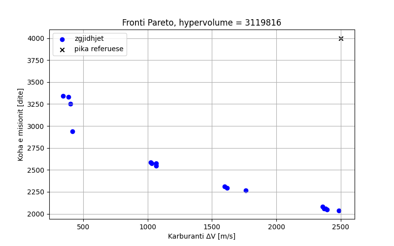

# Trappist Tour (ESA SpOC 2022)

 
Projekt në lëndën **Dizajni dhe Analiza e Algoritmeve (DAA)**.
Optimizim shumë-objektivësh i udhëtimit ndërplanetar të një sonde nëpër të 7 planetët e sistemit TRAPPIST-1.

 
**Notebook-u Kaggle (rezultatet e ekzekutuara):** https://www.kaggle.com/code/kimetesadiku/trappist-tour
 
## Rezultatet në një shikim
 
| | |
|---|---|
| Algoritmi kryesor | Beam Search ($W=8$) + Differential Evolution |
| Hypervolume | **3,119,816** (31.2% e maksimumit teorik 10,000,000) |
| Zgjidhje në submission | **16** plane të plota të pranueshme |
| ΔV më i vogël | **344.6 m/s** (por T = 3341 ditë) |
| Koha më e shkurtër | **2039.5 ditë** (por ΔV = 2484 m/s) |
| Pozita në leaderboard-in zyrtar të ESA-s | **12 nga 20** |
| Verifikimi | shembulli zyrtar i ESA-s riprodhohet saktë (2379.0 m/s, 3469.8 ditë) |
 

 
*Fronti Pareto (nga `plots.plot_pareto` në Kaggle): çdo pikë është një plan i plotë udhëtimi, kryqi i zi është pika referuese.*
 
---

 
## Përmbajtja
 
1. [Problemi](#1-problemi)
2. [Modeli matematikor i udhëtimit](#2-modeli-matematikor-i-udhëtimit)
3. [Algoritmi i zgjidhjes](#3-algoritmi-i-zgjidhjes)
4. [Analiza e kompleksitetit](#4-analiza-e-kompleksitetit)
5. [Fronti Pareto dhe hypervolume](#5-fronti-pareto-dhe-hypervolume)
6. [Rezultatet: të 16 zgjidhjet](#6-rezultatet-të-16-zgjidhjet)
7. [Krahasimi i algoritmeve](#7-krahasimi-i-algoritmeve)
8. [Krahasimi me leaderboard-in e ESA-s](#8-krahasimi-me-leaderboard-in-e-esa-s)
9. [Verifikimi (testet)](#9-verifikimi-testet)
10. [Kufizimet dhe ku mund të përmirësohet](#10-kufizimet-dhe-ku-mund-të-përmirësohet)
11. [Struktura e projektit](#11-struktura-e-projektit)
12. [Si ekzekutohet](#12-si-ekzekutohet)
---